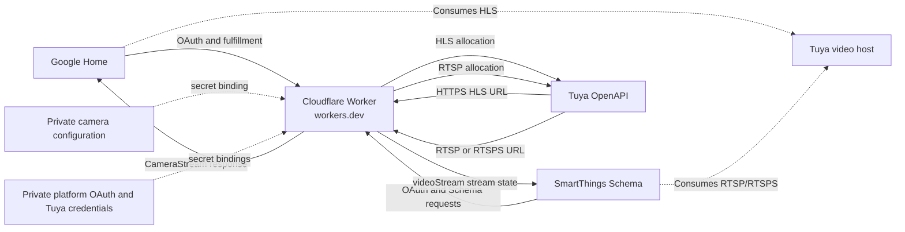

# Realme Camera Bridge: deployed architecture

**Scope:** Cloudflare Worker for Google Home and SmartThings. The Google Home HLS path remains the existing implementation; SmartThings is an additional Schema endpoint that requests Tuya RTSP streams.

## System overview

The Worker handles authorization, device discovery/status, and stream allocation. It does not proxy video bytes, maintain an always-on stream, or require a home computer to remain on. Google Home receives an HTTPS HLS URL; SmartThings receives a Tuya RTSP/RTSPS URL.

## Deployed components

| Component | Responsibility |
| --- | --- |
| Google Home Cloud-to-cloud integration | Calls the OAuth endpoints and `/fulfillment` with SYNC, QUERY, and EXECUTE intents. |
| SmartThings Schema integration | Calls the OAuth endpoints and `/smartthings` with discovery, state refresh, and command interactions. |
| Cloudflare Worker `realme-camera-bridge` | Public HTTPS service on its `workers.dev` hostname. |
| Cloudflare secret bindings | Hold OAuth values, camera data, and Tuya API credentials. |
| Tuya OpenAPI (`openapi.tuyain.com`) | Authenticates API calls, reports camera online status for SmartThings, and allocates HLS or RTSP streams. |
| Tuya video host | Serves the stream at the URL returned by Tuya. |

The Worker has a `PAIRING_RATE_LIMITER` binding configured for five pairing submissions per 60 seconds per client IP key. SmartThings and Google Home pairing attempts use separate keys.

## Routes

| Route | Method | Purpose |
| --- | --- | --- |
| `/health` | `GET` | Returns `{ "status": "ok" }`; used for deployment health checks. |
| `/oauth/authorize` | `GET`, `POST` | Validates the platform's OAuth request, displays the pairing/authorization page, then redirects to the platform callback. |
| `/oauth/token` | `POST` | Exchanges authorization codes or refresh tokens for platform-specific signed tokens. Accepts body credentials or HTTP Basic auth. |
| `/fulfillment` | `POST` | Existing Google Home camera discovery, status, and HLS stream fulfillment. |
| `/smartthings` | `POST` | SmartThings Schema discovery, state refresh, and RTSP stream commands. |
| Other paths | Any | Return `404`. |

JSON request bodies accepted by the fulfillment and Schema handlers are limited to 64 KiB. Tuya API calls have a five-second timeout.

## Platform account linking

Both platforms share the OAuth endpoints and signed-token implementation, while using their own configured client credentials. The redirect URI determines which platform client is selected. This also supports the case where the Google and SmartThings client IDs are the same.

- Google redirect URIs are HTTPS Google OAuth callbacks on the allowlisted hosts and `/r/` paths.
- SmartThings redirect URIs are the US, EU, and APAC Schema callbacks.
- Each platform can use its own pairing PIN; SmartThings falls back to the Google pairing PIN if no SmartThings override is set.
- Pairing codes are validated in constant time and POST attempts are rate-limited.
- Authorization codes expire after 90 seconds and are bound to their client ID and redirect URI.
- Google access and refresh token behavior remains the existing behavior. SmartThings access tokens carry a SmartThings platform claim and its client ID, which keeps them separate from Google tokens even when their client IDs match.
- SmartThings access tokens expire after 24 hours; refresh tokens are signed, self-contained, and expire after five years.

The SmartThings authorization page explicitly identifies SmartThings and requires the user to tap its Authorize button. The Worker does not store an OAuth session database.

## Google Home path

Google Home behavior remains in `/fulfillment` and uses the existing camera configuration and HLS flow:

- `action.devices.SYNC` returns configured cameras with the `CameraStream` trait and advertises HLS.
- `action.devices.QUERY` considers a camera online if its ID exists in the configured camera map; it does not query Tuya for live status.
- `action.devices.EXECUTE` allocates HLS from Tuya, validates that the returned URL is HTTPS without embedded credentials, and returns it as `cameraStreamAccessUrl`.
- `action.devices.DISCONNECT` returns an empty response.

No HLS handling or Google intent mapping is shared with the SmartThings Schema handler.

## SmartThings Schema path

The webhook accepts `st-schema` version `1.0` interactions and validates the SmartThings-specific signed bearer token.

- **`discoveryRequest`** returns configured cameras as `c2c-camera-rtsp-3` devices, with stable external IDs, names, and Realme model metadata.
- **`stateRefreshRequest`** queries Tuya device status and returns `st.healthCheck.healthStatus`. Unknown camera IDs receive `DEVICE-DELETED`; offline or failed status checks return offline health state and `DEVICE-OFFLINE`.
- **`commandRequest` / `st.refresh.refresh`** queries Tuya device status and returns `st.healthCheck.healthStatus`, so SmartThings can refresh camera availability.
- **`commandRequest` / `st.videoStream.startStream`** allocates an RTSP stream from Tuya and returns its URL for both `InHomeURL` and `OutHomeURL`.
- **`commandRequest` / `st.videoStream.stopStream`** clears the reported stream URLs. Tuya stream allocation is on demand and the bridge does not proxy the stream.
- SmartThings command responses include the current `st.healthCheck.healthStatus` state.
- Unsupported capabilities and commands return Schema device errors.

Tuya documents RTSP allocation as `POST /v1.0/users/{uid}/devices/{device_id}/stream/actions/allocate` with `{"type":"rtsp"}`. It may return an `rtsps://` URL; the Worker accepts both RTSP schemes for SmartThings. See [Tuya RTSP API](https://developer.tuya.com/en/docs/iot/rtsp?_source=916fd766b6b05bd472341f20e65e8874&id=Kacsdjcqllyql) and [SmartThings device handler types](https://developer.smartthings.com/docs/devices/cloud-connected/device-handler-types).

## Runtime configuration and deployment

`scripts/deploy-cloudflare.py` uploads the Worker and runtime secret bindings, enables its `workers.dev` hostname, and checks `/health`.

- `oauth-config.json`: Google OAuth values and Google pairing PIN.
- `smartthings-oauth.json`: SmartThings OAuth client ID and secret.
- `camera-config.json`: camera names, Tuya device IDs, and optional Tuya user IDs.
- `tuya-credentials`: Tuya access ID and secret.
- `~/.config/realme-camera-bridge/cloudflare-overrides.json`: optional Google and SmartThings pairing PIN overrides.
- `~/.config/realme-camera-bridge/cloudflare-access.json`: Cloudflare account ID and deployment API token.

The workspace configuration directory defaults to the adjacent `work/` directory in this checkout layout; set `REALME_CAMERA_WORKDIR` to another path. The deployment helper requires local credential files to have mode `600`. Credential files are git-ignored and must not be committed.

## Scope and limits

- Google Home advertises HLS; SmartThings requests Tuya RTSP/RTSPS. Neither platform's video is proxied by the Worker.
- SmartThings motion capability is part of the selected pre-made camera profile, but this implementation does not currently map Tuya motion events into SmartThings motion state.
- SmartThings state refresh depends on Tuya's online status API. Google Home's QUERY behavior is intentionally unchanged and remains configuration-based.
- No FTP service, continuous recording, local relay, or camera management UI is implemented.
