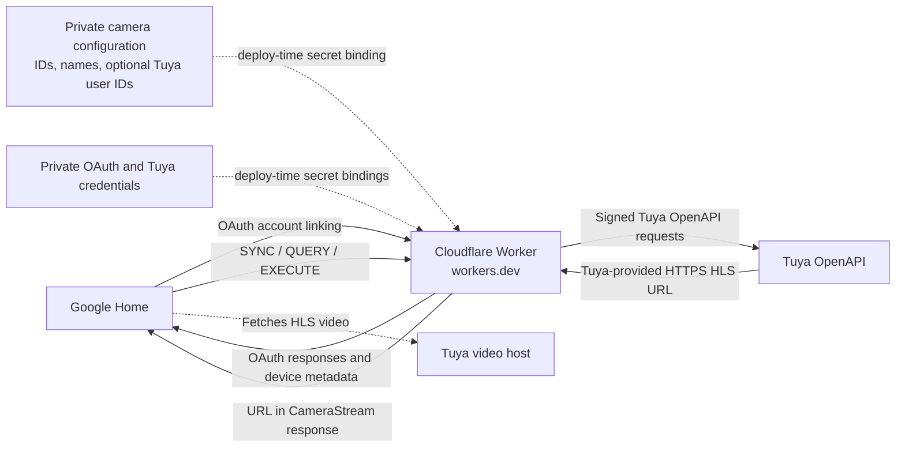

# Realme Camera Bridge: deployed architecture

**Scope:** implementation currently deployed to Cloudflare Workers, checked on 2026-11-26. This describes the working Google Home path only. SmartThings is not implemented in this deployed version.

## System overview

The Worker is the cloud bridge for control and stream allocation. It does not proxy video bytes, keep a live stream open, or require a home computer to stay on. When Google Home requests a stream, the Worker asks Tuya to allocate an HLS stream and returns Tuya's HTTPS URL. Google Home then consumes that stream from the Tuya video host.

## Deployed components

| Component | Responsibility |
| --- | --- |
| Google Home Cloud-to-cloud integration | Sends account-linking requests and camera `SYNC`, `QUERY`, and `EXECUTE` fulfillment requests. |
| Cloudflare Worker `realme-camera-bridge` | Serves OAuth, fulfillment, and health routes at its `workers.dev` hostname. |
| Cloudflare secret bindings | Hold OAuth values, camera configuration, and Tuya API credentials at runtime. |
| Tuya OpenAPI (`openapi.tuyain.com`) | Issues Tuya API access tokens and allocates the camera's HLS stream. |
| Tuya video host | Serves the HLS media at the HTTPS stream URL returned by Tuya. |

The Worker has a Cloudflare rate limiter binding named `PAIRING_RATE_LIMITER`, configured for five pairing submissions per 60 seconds per client IP key. Cloudflare's rate limiting is distributed and may be approximate by location.

## Routes

| Route | Method | Purpose |
| --- | --- | --- |
| `/health` | `GET` | Returns `{ "status": "ok" }`; used by deployment to confirm the Worker responds. |
| `/oauth/authorize` | `GET`, `POST` | Validates Google Home's OAuth request and renders or processes the camera pairing-code form. |
| `/oauth/token` | `POST` | Exchanges an authorization code or refresh token for a signed access token. |
| `/fulfillment` | `POST` | Authenticated Google Home smart-home fulfillment endpoint. |
| Other paths | Any | Return `404`. In particular, `/smartthings` is not a deployed route. |

Fulfillment request bodies are limited to 64 KiB. The Worker rejects requests without a valid signed bearer access token. Tuya HTTP requests have a five-second timeout.

## Google account-linking flow

1. Google Home calls `GET /oauth/authorize` with its OAuth client ID, redirect URI, state, and `response_type=code`.
2. The Worker accepts only the configured Google OAuth client ID, HTTPS redirects on the Google OAuth redirect hosts, a callback path beginning `/r/`, and a non-empty state no longer than 1,024 characters.
3. The page asks for the configured Google Home pairing PIN. Its HTML response has a restrictive content security policy, no-store caching, and no-referrer policy.
4. Google Home submits the PIN to `POST /oauth/authorize`. The Worker applies the configured rate limiter, compares the PIN in constant time, and returns an error if it does not match.
5. On success, the Worker signs a short-lived authorization code with `OAUTH_SIGNING_SECRET` and redirects to Google's callback with the code and original state. The code expires after 90 seconds and is bound to the client ID and redirect URI.
6. Google exchanges the code at `POST /oauth/token`, authenticating with client credentials. The Worker accepts credentials in the request body (Google's default) or HTTP Basic auth (if enabled in the console), then returns signed bearer access and refresh tokens. Access tokens currently have a 180-day lifetime; refresh tokens have a five-year lifetime.

These tokens are signed and self-contained; the Worker does not store an OAuth session database. The configured Google Home account ID is the account identity used for fulfillment.

## Google Home camera fulfillment

Camera IDs are the keys in `CAMERAS_JSON`. Each configured camera supplies a display name, Tuya device ID, and optionally a Tuya user ID used in the allocation endpoint.

- **`action.devices.SYNC`** returns each configured camera as an `action.devices.types.CAMERA` with the `CameraStream` trait. HLS is the only advertised protocol; the stream URL does not require a Google-supplied auth token.
- **`action.devices.QUERY`** reports a camera online when its ID exists in the local camera configuration. This check does **not** query Tuya for live device availability.
- **`action.devices.EXECUTE`** handles `GetCameraStream` when Google lists HLS as a supported protocol. The Worker requests a Tuya token, allocates an HLS stream, validates that the returned URL is HTTPS and has no embedded username or password, then returns it as `cameraStreamAccessUrl`.
- Unknown cameras return `deviceNotFound`; unsupported commands return `functionNotSupported`; stream-allocation failures return `resourceUnavailable`.
- **`action.devices.DISCONNECT`** returns an empty response.

## Tuya request signing and stream allocation

For each stream request the Worker:

1. Requests a Tuya access token using `TUYA_ACCESS_ID` and `TUYA_ACCESS_SECRET`.
2. Builds the stream allocation path using the camera's Tuya device ID and, when configured, its Tuya user ID.
3. Requests allocation with stream type `hls`.
4. Signs OpenAPI requests with HMAC-SHA256 and the Tuya access ID, access token, timestamp, body hash, and request path.
5. Returns only an HTTPS stream URL without embedded credentials.

The Worker does not store the allocated stream URL. A new URL is requested when Google Home asks to start a stream.

## Runtime configuration and deployment

`scripts/deploy-cloudflare.py` uploads the Worker module and runtime secret bindings using the Cloudflare API. It obtains:

- Google OAuth settings from `work/oauth-config.json`.
- Camera IDs and metadata from `work/camera-config.json`.
- Tuya access credentials from the two-line `work/tuya-credentials` file.
- Cloudflare account access and optional Google pairing PIN override from private files under `~/.config/realme-camera-bridge/`.

The deploy script requires private configuration files to have mode `600`. It does not need SmartThings OAuth credentials for this Google-only deployment. It enables the `workers.dev` hostname and checks `/health` after publishing. The last deployment returned a successful health response; that verifies Worker availability, not a full Google Home stream playback.

## Current scope and boundaries

- **Implemented and deployed:** Google Home account linking, camera discovery, configured-device status query, and on-demand HLS stream allocation through Tuya.
- **Not implemented in this deployed version:** SmartThings discovery/refresh/commands, RTSP or FTP service, local video relay, continuous streaming, persistent recording, or camera configuration management through a web UI.
- Device status is configuration-based in the Google `QUERY` handler; it is not a live Tuya online/offline check.
- Google Home is configured to advertise HLS only. No RTSP stream is exposed by this Worker.
