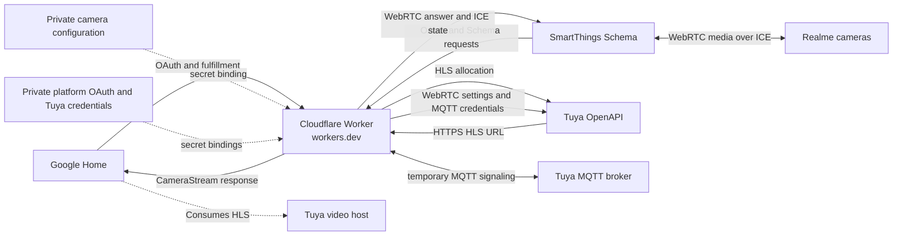

# Realme Camera Bridge: architecture and current status

**Scope:** Cloudflare Worker for Google Home and SmartThings. The Google Home HLS path remains the existing implementation; SmartThings uses the Tuya WebRTC signaling path.

## System overview

The Worker handles authorization, device discovery/status, HLS allocation for Google Home, and short-lived MQTT signaling for SmartThings. It does not proxy video bytes or require a home computer to remain on. Google Home receives an HTTPS HLS URL. SmartThings and the camera exchange WebRTC offers, answers, and ICE candidates through Tuya MQTT; media then flows over the WebRTC ICE path and may use Tuya's TURN relay.

## Deployed components

| Component | Responsibility |
| --- | --- |
| Google Home Cloud-to-cloud integration | Calls the OAuth endpoints and `/fulfillment` with SYNC, QUERY, and EXECUTE intents. |
| SmartThings Schema integration | Calls the OAuth endpoints and `/smartthings` with discovery, state refresh, and command interactions. |
| Cloudflare Worker `realme-camera-bridge` | Public HTTPS service on its `workers.dev` hostname. |
| Cloudflare secret bindings | Hold OAuth values, camera data, and Tuya API credentials. |
| Tuya OpenAPI (`openapi.tuyain.com`) | Authenticates API calls, reports camera online status, allocates HLS for Google Home, and returns SmartThings WebRTC and MQTT configuration. |
| Tuya MQTT broker | Carries SmartThings WebRTC signaling packets to and from the cameras. |
| Tuya video and TURN services | Carry HLS for Google Home and, when needed, relay WebRTC media for SmartThings. |

The Worker has a `PAIRING_RATE_LIMITER` binding configured for five pairing submissions per 60 seconds per client IP key. SmartThings and Google Home pairing attempts use separate keys.

## Tested camera and Tuya account link

The tested hardware is the **realme 360 camera**, which pairs with the Smart Life app and is Tuya-backed. The camera is paired in Smart Life first. The owner then links that Smart Life account to a Tuya IoT cloud project from the project's **Devices > Link Tuya App Account** flow, approving the QR prompt in Smart Life. This authorizes the cloud project to access devices already associated with that app account; the camera itself is not added as a code artifact or a separate repository project. The bridge's private camera configuration uses the Tuya device ID (and, where needed, its Tuya user ID).

Only the realme 360 camera has been tested with this bridge. Other Tuya-backed cameras may be compatible when the linked Tuya project provides the required device status and camera streaming APIs, including HLS allocation for Google Home and WebRTC configuration/signaling for SmartThings. A Tuya or Smart Life label by itself does not establish compatibility; other models and regions remain unverified. See [Tuya's device-linking guide](https://developer.tuya.com/en/docs/iot/link-devices?id=Ka471nu1sfmkl).

## Routes

| Route | Method | Purpose |
| --- | --- | --- |
| `/health` | `GET` | Returns `{ "status": "ok" }`; used for deployment health checks. |
| `/oauth/authorize` | `GET`, `POST` | Validates the platform's OAuth request, displays the pairing/authorization page, then redirects to the platform callback. |
| `/oauth/token` | `POST` | Exchanges authorization codes or refresh tokens for platform-specific signed tokens. Accepts body credentials or HTTP Basic auth. |
| `/fulfillment` | `POST` | Existing Google Home camera discovery, status, and HLS stream fulfillment. |
| `/smartthings` | `POST` | SmartThings Schema discovery, state refresh, and WebRTC signaling commands. |
| Other paths | Any | Return `404`. |

JSON request bodies accepted by the fulfillment and Schema handlers are limited to 64 KiB. Tuya API calls have a five-second timeout.

## Platform account linking

Both platforms share the OAuth endpoints and signed-token implementation, while using their own configured client credentials. The redirect URI determines which platform client is selected. This also supports the case where the Google and SmartThings client IDs are the same.

- Google redirect URIs are HTTPS Google OAuth callbacks on the allowlisted hosts and `/r/` paths.
- SmartThings redirect URIs are the US, EU, and APAC Schema callbacks.
- Each platform can use its own pairing PIN; SmartThings falls back to the Google pairing PIN if no SmartThings override is set.
- Pairing codes are validated in constant time and POST attempts are rate-limited.
- Authorization codes expire after 90 seconds and are bound to their client ID and redirect URI.
- Google access and refresh token behavior remains the existing behavior. SmartThings access tokens carry a SmartThings platform claim and its client ID, which keeps them separate from Google tokens even when their client IDs match.
- SmartThings access tokens expire after 24 hours; refresh tokens are signed, self-contained, and expire after five years.

The SmartThings authorization page explicitly identifies SmartThings and requires the user to tap its Authorize button. The Worker does not store an OAuth session database.

## Google Home path

Google Home behavior remains in `/fulfillment` and uses the existing camera configuration and HLS flow:

- `action.devices.SYNC` returns configured cameras with the `CameraStream` trait and advertises HLS.
- `action.devices.QUERY` considers a camera online if its ID exists in the configured camera map; it does not query Tuya for live status.
- `action.devices.EXECUTE` allocates HLS from Tuya, validates that the returned URL is HTTPS without embedded credentials, and returns it as `cameraStreamAccessUrl`.
- `action.devices.DISCONNECT` returns an empty response.

No HLS handling or Google intent mapping is shared with the SmartThings Schema handler.

## SmartThings Schema path

The webhook accepts `st-schema` version `1.0` interactions and validates the SmartThings-specific signed bearer token.

- **`discoveryRequest`** returns configured cameras as `c2c-camera-webrtc-3` devices, with stable external IDs, names, and Realme model metadata.
- **`stateRefreshRequest`** queries Tuya device status and returns `st.healthCheck.healthStatus` plus WebRTC capability settings. Unknown camera IDs receive `DEVICE-DELETED`; offline or failed status checks return offline health state and `DEVICE-OFFLINE`.
- **`commandRequest` / `st.refresh.refresh`** queries Tuya status and refreshes the WebRTC settings shown to SmartThings.
- **`commandRequest` / `st.webrtc.sdpOffer`** gets Tuya WebRTC settings and temporary MQTT credentials, sends the offer to the camera, then returns fresh TURN details for that stream alongside the camera's SDP answer and any ICE candidates received during setup.
- **`commandRequest` / `st.webrtc.clientIce`** sends SmartThings ICE candidates to the camera and returns any camera candidates received in response.
- **`commandRequest` / `st.webrtc.requestTurnInfo`** supplies Tuya's temporary TURN credentials when SmartThings requests them. **`st.webrtc.end`** sends a disconnect signal to the camera.
- SmartThings command responses include the current `st.healthCheck.healthStatus` state. The MQTT socket is opened only for signaling commands and is closed after the exchange; video bytes do not pass through the Worker.
- Unsupported capabilities and commands return Schema device errors.

Tuya WebRTC uses `GET /v1.0/devices/{device_id}/webrtc-configs` and `POST /v1.0/open-hub/access/config`. The Worker obtains the Tuya user ID from the configured camera data or device details, subscribes to the MQTT source topic, and publishes protocol 302 WebRTC messages to the sink topic. SmartThings uses its built-in `c2c-camera-webrtc-3` device handler. See [Tuya WebRTC](https://developer.tuya.com/en/docs/iot/webrtc?id=Kacsd4x2hl0se) and [SmartThings device handler types](https://developer.smartthings.com/docs/devices/cloud-connected/device-handler-types).

## Known issue: SmartThings TV video buffers

**Status: unresolved as of 2026-11-27. The root cause has not been confirmed.** SmartThings mobile playback works, but the Samsung BU8000 TV (Tizen 6.5) continues to show a loading spinner. Google Home is working through its separate HLS path.

### Evidence from the latest available TV trace

- The TV sent a WebRTC offer with audio and video. The summarized offer had host and server-reflexive ICE candidates, no relay candidate, and no `iceServers` argument (`provided: false`). In that captured attempt, the Worker saw no `requestTurnInfo` or `clientIce` command.
- The Worker had already published TURN information during state refresh. During the offer flow, the SmartThings state callback returned HTTP 204 (`delivered: true`). This shows SmartThings accepted the callback; it does **not** show that the TV read or used the TURN state.
- Tuya returned a full H.264 answer. The TV-specific response kept the video section active, rejected audio, embedded the received host/server-reflexive/relay candidates, and also returned three `deviceIce` states aimed at the active video media section.
- The Worker returned HTTP 200 for the command response with no device error. The TV still buffered.

These results confirm that the Worker completed the observed signaling exchange and returned an answer. They do **not** establish that Tizen accepted that answer, completed ICE checks, established DTLS, received media packets, or decoded/rendered video. There is no TV-side WebRTC state or playback error in the available trace.

An earlier capture showed a 123-character Tuya answer with no media sections. Later traces returned full SDP answers, so treat the 123-character response as a previously observed failure, not as the current known blocker.

### What remains uncertain

The following are hypotheses, not conclusions:

1. The TV viewer may not be applying the TURN information that SmartThings Cloud already holds.
2. The TV may be attempting ICE checks, but the router, extender, NAT path, or Tuya media path may prevent connectivity.
3. The TV may receive an answer but reject SDP details or fail later during DTLS, media reception, or decoding.

The current trace does not distinguish these cases. Do not label this as a confirmed Tizen firmware defect or as a proven router issue.

A SmartThings Community user reported a similar endless spinner on a different Samsung Tizen 6.5 monitor; their trace showed no `requestTurnInfo` for that viewer. This is useful comparison evidence, but it is a user report about another camera and device, not Samsung confirmation of this BU8000 issue or a verified fix: [Tizen 6.5 monitor report](https://community.smartthings.com/t/tizen-6-5-monitor-camera-viewer-never-calls-webrtc-requestturninfo-turnsource-camera/311919).

### Next useful diagnostic

Capture packets at a point that can actually see the TV's traffic: router/AP packet capture, a mirrored switch port, or a setup that routes the TV through the capture laptop. Running `tcpdump` on an ordinary laptop connected to the same switched LAN usually sees only that laptop's traffic. A capture can show whether the TV sends UDP/STUN/TURN traffic and whether replies arrive; it cannot by itself prove video decoding succeeded. See the [Wireshark capture FAQ](https://www.wireshark.org/faq.html).

For a single attempt, correlate the packet capture with the Cloudflare events listed in [CONTRIBUTING.md](CONTRIBUTING.md#collecting-tv-streaming-evidence). Never publish raw packet captures, TURN credentials, OAuth tokens, complete callback payloads, or unredacted camera identifiers.

## Runtime configuration and deployment

`scripts/deploy-cloudflare.py` uploads the Worker and runtime secret bindings, enables its `workers.dev` hostname, and checks `/health`.

- `oauth-config.json`: Google OAuth values and Google pairing PIN.
- `smartthings-oauth.json`: SmartThings OAuth client ID and secret.
- `camera-config.json`: camera names, Tuya device IDs, and optional Tuya user IDs. Google Home keeps using the existing device allocation route; SmartThings can retrieve the Tuya user ID separately for MQTT signaling.
- `tuya-credentials`: Tuya access ID and secret.
- `~/.config/realme-camera-bridge/cloudflare-overrides.json`: optional Google and SmartThings pairing PIN overrides.
- `~/.config/realme-camera-bridge/cloudflare-access.json`: Cloudflare account ID and deployment API token.

The workspace configuration directory defaults to the adjacent `work/` directory in this checkout layout; set `REALME_CAMERA_WORKDIR` to another path. The deployment helper requires local credential files to have mode `600`. Credential files are git-ignored and must not be committed.

## Scope and limits

- Google Home advertises HLS. SmartThings uses WebRTC; neither platform's video bytes are proxied by the Worker.
- SmartThings' pre-made WebRTC camera profile includes motion state, currently reported as inactive; Tuya motion events are not mapped yet.
- SmartThings state refresh depends on Tuya's online status API. Google Home's QUERY behavior is intentionally unchanged and remains configuration-based.
- No FTP service, continuous recording, local relay, or camera management UI is implemented.

For the official platform documentation and console links used by this project, see [REFERENCES.md](REFERENCES.md).
